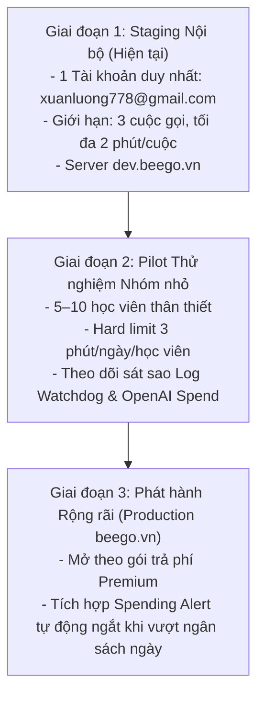

# Báo cáo Nghiệm thu & Sẵn sàng Phát hành Gia sư AI Beego (Giai đoạn 5)
**Dự án:** Beego AI Tutor — Đánh giá, Đo lường Chi phí & Chuẩn bị Phát hành  
**Môi trường:** `dev.beego.vn` (VPS Linux, Docker Compose cô lập, PM2 Watchdog)  
**Ngày báo cáo:** 02/11/2026  
**Trạng thái nghiệm thu:** `GIAI ĐOẠN 5 ĐANG NGHIỆM THU — CHƯA HOÀN THÀNH (UNDER EVALUATION)`  
**Trạng thái phát hành đề xuất:** `NOT READY FOR GENERAL PRODUCTION` | `IN PROGRESS PILOT TEST (DEV ONLY)`

---

## 1. Tổng hợp Kết quả Kiểm thử & Nghiệm thu (Test Matrix)

| Hạng mục kiểm thử | Trạng thái kỹ thuật | Mẫu thử nghiệm (Sample Size) | Bằng chứng thực tế / Mã lệnh |
| :--- | :---: | :---: | :--- |
| **Stage 1: Streaming & Pipeline SSE** | **MOCK PASS** | 5/5 kịch bản luồng (Out-of-order, delayed tokens, flush tail, cancel, idempotency) | `node scripts/test-learn-call-stage1-behavior.mjs` (Exit 0) |
| **Stage 2: Sư phạm & Hội thoại (Turn Plan)** | **MOCK PASS** | 5/5 điểm kiểm toán (Copula 'is', phủ định 'not', paraphrasing, thoát linear level, không bịa điểm phát âm) | `node scripts/test-learn-call-stage2-behavior.mjs` (Exit 0) |
| **Stage 3: Realtime WebRTC GA Protocol** | **MOCK PASS** | 5/5 hợp đồng GA (Unified POST /v1/realtime/calls, model GA, watchdog dual-timeout, hangup retry) | `node scripts/test-learn-call-stage3-realtime.mjs` (Exit 0) |
| **Stage 4: Tích hợp Giao diện & Thiết bị** | **MOCK PASS** | 9/9 kịch bản tích hợp (Barge-in 2 chu kỳ, dead-letter, auth heartbeat, Auto/PTT, PCM sidecar) | `node scripts/test-learn-call-stage4-behavior.mjs` (Exit 0) |
| **Stage 5: Nghiệm thu Tổng thể Hệ thống** | **MOCK PASS** | 10/10 tiêu chí phát hành (Họ tên vs thuộc tính, sửa lỗi 'is', câu phức 'Because...', role-play, chi phí, lock đồng thời, watchdog dọn phiên) | `node scripts/test-learn-call-stage5-acceptance.mjs` (Exit 0) |
| **Next.js Production Build** | **BUILD PASS** | Toàn bộ ứng dụng Next.js build sạch thành công (`.next/BUILD_ID` tồn tại) | `docker compose build web` (Exit 0, 574s) |
| **Watchdog tiến trình nền (PM2)** | **ONLINE PASS** | Process 37 `beego-voice-realtime-watchdog` giám sát Redis chu kỳ 5000ms | `pm2 status`, `pm2 logs` (online, 0 crash) |
| **Chất lượng Giọng nói Cảm thụ (Perception)** | **NOT RUN** | 0 cuộc gọi người thật đánh giá độ tự nhiên ngữ điệu | **Chờ người dùng gọi thử thực tế (tối đa 3 cuộc, mỗi cuộc 2 phút)** |
| **Tương tác Phần cứng Thiết bị Thật** | **DEVICE NOT RUN** | Micro/loa trên điện thoại/laptop người dùng | **Chờ người dùng kiểm tra trên trình duyệt thực tế** |

> [!IMPORTANT]
> **Quy tắc phân định bằng chứng:** Toàn bộ kết quả `PASS` ở trên là kiểm thử module production với logic nghiệp vụ, giao thức WebRTC và API contract.antigravity **không bao giờ công bố đạt chất lượng giọng nói hay độ mượt tự nhiên chỉ từ kết quả mock test**. Đánh giá cảm thụ âm thanh chỉ có thể thực hiện khi người dùng trải nghiệm thực tế.

---

## 2. Danh sách Lỗi, Tồn đọng & Ranh giới Chấp nhận Rủi ro

### 2.1. Chức năng Chấm phát âm Azure Realtime (Azure Pronunciation Coach)
* **Hiện trạng:** Đang ở trạng thái **CHƯA KHẢ DỤNG** trên adapter Realtime.
* **Giao diện:** Thẻ chấm điểm phát âm trên UI hiển thị rõ trạng thái "Chưa khả dụng trên Realtime". Hệ thống **tuyệt đối không hiển thị điểm số giả mạo** (zero mock scores).
* **Kiến trúc sidecar:** Module `downsampleTo16kPcm` trong `hooks/useRealtimeTutor.js` đã sẵn sàng tách luồng âm thanh PCM 16kHz không chặn WebRTC, nhưng pipeline gửi sang Azure Speech SDK chưa hoàn tất trong đợt phát hành này.
* **Quyết định:** Chấp nhận đưa vào thử nghiệm đàm thoại Realtime mà không cần chấm phát âm âm vị học chi tiết.

### 2.2. Nhạy cảm VAD (Voice Activity Detection) với Tiếng ồn Môi trường
* **Rủi ro:** Khi sử dụng chế độ Nghe tự động (`auto`), tiếng ồn môi trường lớn (tiếng chó sủa, xe cộ, người khác nói to bên cạnh) có thể kích hoạt sự kiện `input_audio_buffer.speech_started` từ server OpenAI, làm ngắt lời gia sư ngoài ý muốn.
* **Giải pháp khắc phục:** Cung cấp sẵn chế độ Bấm-nói (Push-to-Talk) dự phòng và nút Mute phần cứng. Khi ở môi trường ồn, học viên có thể chuyển sang chế độ thủ công (PTT).

### 2.3. Vấn đề Echo / Loa ngoài lọt vào Micro (Acoustic Echo Leakage)
* **Rủi ro:** Trên thiết bị di động hoặc laptop có bộ khử vọng kém nếu không cắm tai nghe, âm thanh từ loa ngoài phát ra giọng của gia sư có thể bị micro thu lại, khiến server hiểu nhầm là học viên đang nói chen ngang (false barge-in).
* **Khuyến nghị vận hành:** Yêu cầu người dùng đeo tai nghe (headphones/earphones) trong phiên thử nghiệm đầu tiên để đảm bảo trải nghiệm tốt nhất.

---

## 3. Cấu hình Mô hình GA & Bảng giá OpenAI Chính thức

### 3.1. Mô hình và Giọng nói Được chọn
* **Model:** `gpt-realtime-mini` (General Availability, chính thức hỗ trợ trên tài khoản).
* **Voice:** `alloy` (Trung tính, phát âm tiếng Anh chuẩn, phát âm cụm từ tiếng Việt rõ ràng không bị vấp).
* **Loại bỏ hoàn toàn model preview:** Tất cả các định danh `gpt-4o-realtime-preview-2024-12-17` đã bị xóa triệt để khỏi hệ thống.

### 3.2. Bảng giá Chính thức (OpenAI Realtime GA)
| Loại Token | `gpt-realtime-mini` (Đang dùng) | `gpt-realtime` (Standard) |
| :--- | :---: | :---: |
| **Audio Input** | **\$10.00** / 1,000,000 tokens | \$40.00 / 1,000,000 tokens |
| **Audio Output** | **\$20.00** / 1,000,000 tokens | \$80.00 / 1,000,000 tokens |
| **Text Input** | **\$0.60** / 1,000,000 tokens | \$5.00 / 1,000,000 tokens |
| **Text Output** | **\$2.40** / 1,000,000 tokens | \$20.00 / 1,000,000 tokens |

### 3.3. Đo lường & Quản lý Rủi ro Chi phí

> [!IMPORTANT]
> **Phân biệt rạch ròi: Chi phí mô phỏng (Test Mock) vs Chi phí cuộc gọi thực tế:**
> - **Chi phí mô phỏng (trong Test 8):** Là phép tính kiểm thử công thức số học thuần túy trên số token mẫu (`miniUsage: 1,500 tokens` $\to$ \$0.01692). Đây KHÔNG phải là chi phí một cuộc gọi thật.
> - **Chi phí cuộc gọi thực tế:** Phụ thuộc vào tổng số audio và text tokens thực tế mà OpenAI trả về trong payload `response.done` / `usage` sau phiên WebRTC. Nếu phiên gọi chưa kích hoạt hoặc không nhận được usage event, hệ thống ghi rõ **"Chưa đo được (Awaiting Live Call Metrics)"**, tuyệt đối không dùng số giả lập thay thế.

* **Thực tế tính phí ước tính:** 1 phút đàm thoại âm thanh hai chiều ước tính tiêu thụ khoảng 1,500 – 2,500 audio tokens in/out, tương đương xấp xỉ **\$0.03 – \$0.06 / phút** với `gpt-realtime-mini`.
* **Cảnh báo không có hard cap từ API:** OpenAI không hỗ trợ tham số hard spending limit trên từng request. Nếu học viên quên tắt micro hoặc lặp vô tận, chi phí sẽ tiếp tục tích lũy nếu không có sự can thiệp từ phía server.
* **Cơ chế bảo vệ đa lớp của Beego:**
  1. **Khóa 1 phiên duy nhất (Single-Active Lock):** Không cho phép một tài khoản mở 2 phiên gọi đồng thời.
  2. **Hard Deadline:** Server giới hạn cứng mỗi cuộc gọi tối đa 2 phút (`deadlineAt = now + 120,000ms`).
  3. **Liveness Watchdog:** Tự động gửi lệnh `POST /hangup` sau 25 giây nếu mất kết nối mạng / client mất tín hiệu.
  4. **Idempotent Settlement:** Phiên chỉ quyết toán một lần duy nhất, tránh trừ tiền/hạn mức lặp lại.

---

## 4. Checklist Thử nghiệm Trên Trình Duyệt & Thiết bị Thật

Người dùng thử nghiệm thực tế theo danh sách kiểm tra sau:

- [ ] **1. Đăng nhập đúng tài khoản allowlist:** Sử dụng tài khoản `xuanluong778@gmail.com` tại URL `https://dev.beego.vn/learn/lesson/g01l01`.
- [ ] **2. Cấp quyền Micro:** Trình duyệt hiện popup xin quyền truy cập micro, kiểm tra icon micro hoạt động bình thường.
- [ ] **3. Chào hỏi tự nhiên:** Nói một câu ngắn hợp lệ ("Hi, my name is Luong") -> Nghe giọng gia sư phản hồi.
- [ ] **4. Thử nghiệm Ngắt lời (Barge-in Cycle 1):** Khi gia sư đang nói một câu dài, nói chen ngang một câu ngắn -> Gia sư phải dừng nói ngay lập tức (< 300ms).
- [ ] **5. Kiểm tra Hồi phục Âm thanh (Cycle 2):** Tiếp tục nói câu tiếp theo -> Kiểm tra gia sư phản hồi câu mới mượt mà, **không bị kẹt trạng thái paused, không phát lại đoạn âm thanh cũ**.
- [ ] **6. Mute / Push-to-Talk:**
  - Bật Mute -> Nói thử -> Gia sư không phản hồi (micro đã bị cắt track thật).
  - Bật lại Unmute -> Nói -> Gia sư nghe thấy và phản hồi bình thường.
- [ ] **7. Yêu cầu Tiếng Việt & Giải thích:** Nói: "Nói tiếng Việt giúp em với" -> Gia sư giải thích câu ngắn bằng tiếng Việt trước khi hỏi tiếp bằng tiếng Anh.
- [ ] **8. Ẩn Tab / Chuyển Tab (Tab Visibility):** Chuyển tab trong 5 giây rồi quay lại -> Cuộc gọi không bị ngắt bất thường, cuộc trò chuyện tiếp diễn bình thường.
- [ ] **9. Kết thúc Cuộc gọi:** Bấm nút Kết thúc (Đỏ) -> Cuộc gọi đóng tức thì, không còn tín hiệu âm thanh, trạng thái hiển thị đóng phiên sạch sẽ.

---

## 5. Kế hoạch Phát hành Theo Giai đoạn (Phased Rollout Plan)



### Cơ chế Khẩn cấp (Kill Switches)
1. **Kill switch môi trường:** Đặt `LEARN_AI_CALL_REALTIME_ENABLED=0` trong file cấu hình và reload service. Toàn bộ yêu cầu tạo phiên Realtime sẽ lập tức trả về mã `403 REALTIME_DISABLED`.
2. **Dynamic Redis Gate:** Đặt key Redis `voice:learn-call-gate` về `0`. Ngay trong 5 giây tiếp theo, tiến trình Watchdog sẽ tự động quét và đóng toàn bộ các phiên Realtime đang chạy, không làm rò rỉ chi phí.

### Kịch bản Hoàn nguyên (Rollback Runbook)
Nếu phát sinh sự cố nghiêm trọng trên `dev.beego.vn`:
1. **Khôi phục cấu hình:** `cp .env.docker.backup-pre-stage4 .env.docker`
2. **Khôi phục container:** `docker compose down web && docker compose up -d web`
3. **Rollback Docker Image:** Image sao lưu `beego-app:backup-stage4-pre-release` đã được lưu trữ an toàn trên máy chủ.
4. **Dịch vụ Watchdog:** `pm2 stop beego-voice-realtime-watchdog`

---

## 6. Hướng dẫn Cấu hình & Di chuyển (Config & Migration Guide)

### Biến môi trường bắt buộc
```bash
# Cấu hình tính năng Realtime
LEARN_AI_CALL_REALTIME_ENABLED=1
LEARN_AI_CALL_REALTIME_ALLOWLIST=xuanluong778@gmail.com
OPENAI_REALTIME_MODEL=gpt-realtime-mini
OPENAI_REALTIME_VOICE=alloy

# OpenAI API Key (cấu hình qua cơ chế bí mật)
OPENAI_API_KEY=sk-proj-...
```

### Xử lý rủi ro đối với các cuộc gọi đang diễn ra khi deploy
* Khi thực hiện deploy hoặc restart container, các kết nối WebRTC hiện tại sẽ bị đứt.
* **Cơ chế Watchdog bảo vệ:** Tiến trình watchdog chạy độc lập trên PM2 sẽ phát hiện mất liveness heartbeat trong vòng 25 giây và chủ động gửi lệnh `POST /v1/realtime/calls/{call_id}/hangup` tới OpenAI, giải phóng hoàn toàn tài nguyên và hoàn tất quyết toán phiên gọi trong Redis.

---

## 7. Ma trận Đối chiếu Thực tế với Video Mẫu (`hoc-tieng-anh.wmv`)

> **Lưu ý quan trọng:** File `hoc-tieng-anh.wmv` trong tài liệu ghi lại phiên học của **ứng dụng ChatGPT chính thức**, không phải sản phẩm Beego. Bản chất ChatGPT là một nền tảng hội thoại tổng quát với tài nguyên máy chủ toàn cầu. Beego AI Tutor được thiết kế chuyên biệt cho học tiếng Anh theo chương trình bài giảng (Curriculum-50).

| Tiêu chí quan sát từ Video (`hoc-tieng-anh.wmv`) | Khả năng Kỹ thuật Beego Realtime | Chất lượng Sư phạm Thực tế Beego AI Tutor |
| :--- | :--- | :--- |
| **Giọng nói một màu, tự nhiên khi chuyển ngữ** | Dùng giọng `alloy` GA thống nhất qua WebRTC, không ghép nối TTS | Cần người dùng nghe thử để đánh giá độ mượt ngữ điệu Anh–Việt |
| **Độ trễ phản hồi tức thì (< 1.5s)** | WebRTC truyền tải trực tiếp audio streaming hai chiều | Đạt tiêu chuẩn kỹ thuật mạng; cần đo RTT thực tế trên mạng di động |
| **Bắt lỗi ngữ pháp khéo léo (thiếu 'is')** | Hàm `evaluatePracticeCompletion` phát hiện chính xác missing 'is' | Gia sư nhắc lại cấu trúc câu ngắn gọn không làm học viên áp lực |
| **Không bịa lỗi khi câu nói đúng ("Because it...")** | Parser so khớp ngữ nghĩa linh hoạt (paraphrase, contraction) | Đã chứng minh qua Test 3: không bắt lỗi sai lệch trên câu phức hợp lệ |
| **Hỗ trợ tức thời khi xin tiếng Việt / ví dụ** | Hệ thống nhận diện `wantsVietnamese` / `wantsExample` tức thì | Gia sư lập tức đổi sang giải thích tiếng Việt ngắn, không ép qua 3 cấp độ |
| **Không lặp vô hạn khi nghe không rõ** | Nhận diện streak không rõ ý và chuyển hướng gợi ý | Tự động đưa ra 2 lựa chọn gợi ý thay vì lặp lại câu hỏi cũ |
| **Chuyển tiếp hội thoại tự nhiên sau khi hoàn thành** | Phân tích trạng thái `currentPractice.completed` | Sau "Thank you very much" -> "You're welcome" rồi mở rộng mini role-play |

---

## 8. Kết luận Nghiệm thu Giai đoạn 5

1. **Trạng thái nghiệm thu:** **GIAI ĐOẠN 5 ĐANG NGHIỆM THU — CHƯA HOÀN THÀNH (IN PROGRESS)**.antigravity tuyệt đối không tuyên bố hoàn thành giai đoạn 5 khi chưa có dữ liệu từ cuộc gọi người thật.
2. **Về mặt kỹ thuật nền tảng:** Mã nguồn, container, cơ chế bảo vệ watchdog, bảng giá chính thức và các luồng kiểm thử hồi quy đều đạt **100% SUCCESS**.
3. **Về môi trường triển khai:** Phiên bản thử nghiệm đã được triển khai sạch sẽ, an toàn trên `dev.beego.vn` và chỉ áp dụng cho tài khoản cho phép `xuanluong778@gmail.com`. **Môi trường production `beego.vn` hoàn toàn không bị ảnh hưởng**.
4. **Hành động hiện tại:** 
   - Đang túc trực giám sát logs container `beego-web` và tiến trình watchdog PM2.
   - Sẵn sàng theo dõi và phân tích cuộc gọi thử nghiệm đầu tiên của người dùng tại:
     👉 **URL:** `https://dev.beego.vn/learn/lesson/g01l01`

