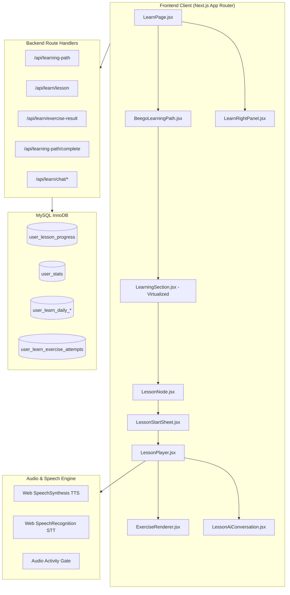
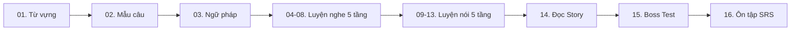

# ĐẶC TẢ CHI TIẾT STACK, GIAO DIỆN, TÍNH NĂNG & NỘI DUNG BÀI HỌC CHUẨN PHÂN CẤP TRÌNH ĐỘ (BEEGO LEARN SPECIFICATION)

> **Tệp tài liệu:** `docs/beego-learn-curriculum-content-spec.md`  
> **Dự án:** Beego.vn (Nền tảng học tiếng Anh)  
> **Mục tiêu:** Cung cấp tài liệu tra cứu toàn diện về kiến trúc công nghệ, giao diện, tính năng và **đặc tả chi tiết nội dung 128 bài học phân cấp theo chuẩn CEFR (A0 → B1+)**, làm cơ sở chuẩn mực để biên soạn, nâng cấp và mở rộng nội dung bài học.

---

## MỤC LỤC
1. [Stack Công Nghệ Trong Tab Học](#1-stack-công-nghệ-trong-tab-học)
2. [Thiết Kế Giao Diện (UI/UX) & Trải Nghiệm Học](#2-thiết-kế-giao-diện-uiux--trải-nghiệm-học)
3. [Hệ Thống Tính Năng & Nghiệp Vụ Cốt Lõi](#3-hệ-thống-tính-năng--nghiệp-vụ-cốt-lõi)
4. [Khung Phân Cấp Trình Độ CEFR (A0 → B1+)](#4-khung-phân-cấp-trình-độ-cefr-a0--b1)
5. [Cấu Trúc Chuẩn Hóa 16 Node Mỗi Cửa (Gate Blueprint)](#5-cấu-trúc-chuẩn-hóa-16-node-mỗi-cửa-gate-blueprint)
6. [Chi Tiết Nội Dung Giáo Trình 8 Phần Hiện Có](#6-chi-tiết-nội-dung-giáo-trình-8-phần-hiện-có)
7. [Quy Chuẩn Biên Soạn Nội Dung Bài Học Chuẩn (Content Authoring Guidelines)](#7-quy-chuẩn-biên-soạn-nội-dung-bài-học-chuẩn-content-authoring-guidelines)
8. [Hướng Dẫn Mở Rộng & Nâng Cấp Giáo Trình](#8-hướng-dẫn-mở-rộng--nâng-cấp-giáo-trình)

---

## 1. STACK CÔNG NGHỆ TRONG TAB HỌC

Tab **Học** (`/` - `HomePage` / `LearnPage`) và **Trình làm bài** (`/learn/lesson/[lessonId]`) được xây dựng trên nền tảng kỹ thuật tối ưu, không phụ thuộc vào thư viện ngoài nặng nề:



### 1.1. Tầng Giao diện & Hiển thị (Frontend)
- **Framework:** Next.js (App Router), React 18/19.
- **Hệ thống Styling:**
  - `app/beego-learn.css` (~2,500 dòng CSS tối ưu cho bản đồ học, thẻ tiến độ, header dính).
  - `app/beego-lesson-player.css` (~600 dòng CSS chuẩn hóa giao diện làm bài, feedback bar, option cards).
  - Tách CSS Module cho thành phần AI đàm thoại: `LessonAiConversation.module.css`.
  - Toàn bộ dùng Vanilla CSS kết hợp CSS Custom Properties (`--beego-learn-*`), không dùng Tailwind.
- **Tối ưu hóa hiệu năng render:**
  - `useVirtualLearnSections.js`: Ứng dụng `IntersectionObserver` để ảo hóa danh sách (Virtualization). Chỉ render cây DOM các Cửa nằm trong viewport, thay thế các cửa ở xa bằng placeholder có chiều cao ước tính.
  - `useScrollToActiveNode.js`: Tự động cuộn mượt (smooth scroll) đến bài học đang kích hoạt khi người học mở app.
  - `ResizeObserver`: Tự động tính toán chiều cao sticky header để thiết lập khoảng cách đệm `--beego-learn-header-offset`.
- **Xử lý âm thanh & nhận diện giọng nói:**
  - Client-side Text-To-Speech: `playLessonTts` sử dụng `speechSynthesis` của trình duyệt.
  - Client-side Speech-To-Text: `startLessonSpeechCapture` sử dụng Web Speech Recognition (`webkitSpeechRecognition`).
  - Cổng kiểm soát âm thanh (`createPanelActivityGate`): Dập tắt ngay âm thanh và tiến trình ghi âm khi người học chuyển câu hoặc đóng cửa sổ làm bài.
- **Giao tiếp trạng thái (Event-Driven):**
  - Sử dụng sự kiện DOM tùy biến `LEARNING_PATH_UPDATED_EVENT` phát ra từ trình làm bài để đồng bộ lại streak, điểm thưởng và huy hiệu trên trang chủ mà không cần tải lại trang.

### 1.2. Tầng Máy chủ & Nghiệp vụ (Backend)
- **Runtime:** Node.js Route Handlers.
- **Kiểm soát bảo mật & Chống gian lận:**
  - CSRF check: Kiểm tra mutation origin an toàn.
  - Rate limiting: Kiểm soát tần suất submit câu hỏi và hoàn thành bài học.
  - Server-side Grading: Chấm điểm bài tập hoàn toàn phía máy chủ qua `/api/learn/exercise-result`, không bao giờ gửi đáp án đúng về client trước khi người học nộp bài.
- **Cơ sở dữ liệu (MySQL InnoDB với Connection Pool `mysql2/promise`):**
  - `user_lesson_progress`: Ghi nhận tiến độ bài học, điểm số cao nhất, XP và Honey đạt được.
  - `user_stats`: Tổng hợp điểm tích lũy toàn cục, chuỗi streak, bài học đang kích hoạt.
  - `user_learn_daily_settings` & `user_learn_daily_progress`: Quản lý mục tiêu ngày, tính streak theo múi giờ `Asia/Ho_Chi_Minh`.
  - `user_learn_exercise_attempts`: Nhật ký làm từng câu hỏi chi tiết, phục vụ đo lường Mastery và phân tích lỗi sai.

---

## 2. THIẾT KẾ GIAO DIỆN (UI/UX) & TRẢI NGHIỆM HỌC

### 2.1. Bố cục 2 Cột Responsive
- **Màn hình Mobile (< 1024px):** 1 cột dọc trực quan:
  - Header dính trên cùng (`LearnHeader.jsx`): Tên người học, vị trí Cửa học, nút Hướng dẫn.
  - Thanh thống kê nhanh (`LearnMobileStats.jsx`): Hiển thị Streak, Honey Point, thanh Daily Goal.
  - Bong bóng linh vật (`BeegoMascotBubble.jsx`): Chú ong Beego động viên theo ngữ cảnh.
  - Lộ trình bài học dạng bản đồ zig-zag trung tâm.
  - Thanh điều hướng đáy 5 nút cố định (`BottomNav.jsx`).
- **Màn hình Desktop (≥ 1024px):** 2 cột mở rộng hiện đại:
  - **Cột chính (Trái - 65%):** Chứa các thẻ phân tích năng lực (Đề xuất hôm nay, Tiến độ 7 ngày, Thành tích) và toàn bộ bản đồ lộ trình học zig-zag.
  - **Cột Dashboard cố định (Phải - 35% - `LearnRightPanel.jsx`):** Ngọn lửa Streak, số dư Honey, thanh Daily Goal, tiến độ nhiệm vụ ngày, hộp rương sắp mở và nút "Continue Learning" đưa thẳng vào bài học kế tiếp.

### 2.2. Bản Đồ Lộ Trình Học Zig-zag (Duolingo Style)
- **Chu kỳ uốn lượn:** `Trái → Giữa → Phải → Giữa`.
- **Visual Node đa dạng:**
  - Đường kính node: 64px (mặc định), 72px (bài đang học), 76px (bài Boss Test).
  - Trạng thái `Locked`: Màu xám, icon ổ khóa, không tương tác được.
  - Trạng thái `Active`: Hiệu ứng viền phát sáng pulsating màu vàng mật ong (`#ffb020`), kèm huy hiệu "BẮT ĐẦU" hoặc "VƯỢT CỬA?".
  - Trạng thái `Completed`: Icon dấu tích xanh `✓`, hiệu ứng bounce vui nhộn.
  - Trạng thái `Skipped`: Dành cho các bài được miễn qua bài kiểm tra Placement Test.
- **Đường nối uốn lượn (Connectors):** Các đoạn nối mềm mại liên kết các node liên tiếp.
- **Banner đầu Cửa (`UnitBanner.jsx`):** Phân định ranh giới giữa các chủ đề lớn, nền gradient tím/vàng hiện đại.

### 2.3. Trình Làm Bài (`LessonPlayer.jsx`)
- **Thanh trạng thái đỉnh (Top Bar):** Nút thoát có hộp thoại xác nhận, thanh tiến độ % câu hỏi chuyển động mượt, số tim mạng sống (3 mạng ❤️).
- **Khu vực hiển thị câu hỏi (`ExerciseRenderer.jsx`):** Nhãn kỹ năng, câu hỏi gợi ý, mascot minh họa, các khối lựa chọn hoặc ngân hàng từ vựng.
- **Thanh phản hồi đáy (`LessonFeedbackBar.jsx`):**
  - Khi đúng: Màu xanh lá cây rực rỡ, âm thanh vui tươi, nút "Tiếp tục".
  - Khi sai: Màu đỏ nổi bật, hiển thị đáp án đúng kèm **phần giải thích chi tiết bằng tiếng Việt**.
- **Màn hình kết thúc (`LessonCompleteScreen.jsx`):** Cúp vàng chiến thắng, tỷ lệ chính xác %, cộng thưởng XP & Honey, cập nhật Streak và nút mở phòng luyện nói AI.

### 2.4. Trợ Lý Đàm Thoại AI (`LessonAiConversation.jsx`)
- Mở ra sau khi hoàn thành bài học để thực hành giao tiếp tự nhiên dựa trên ngữ cảnh vừa học.
- Hỗ trợ nhập liệu linh hoạt bằng cả bàn phím lẫn micro giọng nói.
- AI phát âm câu trả lời bằng giọng bản xứ, kèm nút dịch tiếng Việt, nút chỉ điểm lỗi sai ngữ pháp và mẹo phát âm chuẩn xác.

---

## 3. HỆ THỐNG TÍNH NĂNG & NGHIỆP VỤ CỐT LÕI

### 3.1. Quy Tắc Nghiệp Vụ Mở Khóa Tuần Tự
- Không thể làm bài số `N` nếu chưa hoàn thành bài số `N-1`.
- Kiểm tra chặt chẽ ở cả giao diện client lẫn API máy chủ (`completeLessonForUser`).
- Khi làm lại bài cũ: Chỉ cập nhật điểm số tốt hơn, không cộng dồn trùng lặp XP hay Honey ảo (Idempotent).

### 3.2. Hệ Thống Động Lực (Gamification)
- **Chuỗi ngày học (Streak Engine):** Tính theo múi giờ Việt Nam (`Asia/Ho_Chi_Minh`), duy trì khi học tối thiểu 1 bài/ngày.
- **Mục tiêu ngày (Daily Goal):** Mặc định 30 XP/ngày (~2-3 bài học), tự động kích hoạt hiệu ứng chúc mừng khi hoàn thành.
- **Mật ong (Honey Points):** Đơn vị tích lũy điểm thưởng từ việc làm bài đúng và vượt qua các mốc kiểm tra.
- **Mạng sống (Hearts/Lives):** Bắt đầu với 3 mạng trong một bài học. Khi trả lời sai bị trừ 1 mạng.

### 3.3. Đánh Giá Xếp Lớp Đầu Vào (Placement Test)
- Bài kiểm tra ngắn gọn thích ứng (Adaptive Test) đánh giá khả năng của người học mới.
- Ước tính trình độ CEFR (A0, A1, A2...) và đề xuất vị trí bắt đầu thích hợp (Smart Start), cho phép bỏ qua các bài quá dễ mà không cộng dồn XP ảo.

---

## 4. KHUNG PHÂN CẤP TRÌNH ĐỘ CEFR (A0 → B1+)

Toàn bộ 8 Phần học được ánh xạ chính xác theo khung tham chiếu trình độ ngôn ngữ chung Châu Âu (CEFR):

| Phần (Part) | Trình độ CEFR | Tên phân cấp | Đối tượng & Mục tiêu năng lực | Tiêu chuẩn đầu ra kỹ năng |
| :---: | :---: | :--- | :--- | :--- |
| **Phần 1** | **A0** | Mất gốc / Làm quen | Người hoàn toàn chưa biết gì hoặc mất gốc tiếng Anh. | Nhận biết bảng chữ cái Alphabet, số đếm 1-100, chào hỏi xã giao, giới thiệu tên bản thân. |
| **Phần 2** | **A0** | Sinh hoạt hằng ngày | Người bắt đầu xây dựng thói quen giao tiếp đơn giản. | Mô tả các hoạt động thường nhật (thức dậy, ăn uống, đi làm), nắm vững thì Hiện tại đơn cơ bản. |
| **Phần 3** | **A1** | Giao tiếp đời sống | Người học có vốn từ căn bản, bắt đầu ra ngoài đời thực. | Hỏi giá, mua sắm ở siêu thị, chợ, số lượng (How much / How many), gọi món ăn đơn giản. |
| **Phần 4** | **A1** | Gia đình & Cảm xúc | Giao tiếp về các mối quan hệ thân cận và cảm xúc cá nhân. | Kể về thành viên gia đình, tính cách, sở thích, sử dụng thành thạo đại từ sở hữu (my, your, his, her). |
| **Phần 5** | **A1+** | Công việc & Học tập | Giao tiếp trong môi trường công sở và trường học. | Giới thiệu nghề nghiệp, mô tả nhiệm vụ đang thực hiện (Hiện tại tiếp diễn), trao đổi công việc cơ bản. |
| **Phần 6** | **A2** | Du lịch & Tình huống | Xử lý các tình huống độc lập khi đi lại ngoài thực tế. | Check-in sân bay, đặt phòng khách sạn, hỏi đường, đưa ra yêu cầu lịch sự với Can / Could. |
| **Phần 7** | **B1** | Trung cấp giao tiếp | Tự tin tham gia các cuộc trao đổi công việc chuyên nghiệp. | Tham gia cuộc họp, viết email công việc, tường thuật lại các sự việc đã diễn ra bằng Quá khứ đơn. |
| **Phần 8** | **B1+** | Nâng cao & Tự tin | Trình bày quan điểm cá nhân, lập luận và bảo vệ ý kiến. | Thuyết trình ngắn, phản biện quan điểm, sử dụng nhuần nhuyễn các liên từ logic (although, however, therefore). |

---

## 5. CẤU TRÚC CHUẨN HÓA 16 NODE MỖI CỬA (GATE BLUEPRINT)

Mỗi Cửa (Gate) là một chu trình học tập khép kín theo mô hình tiếp thu tự nhiên: **Nạp từ vựng → Nạp mẫu câu → Đúc kết ngữ pháp → Luyện phản xạ Nghe → Luyện phản xạ Nói → Đọc hiểu ngữ cảnh → Kiểm tra vượt cửa → Ôn tập lặp lại**.



### Bảng Đặc Tả Chi Tiết 16 Node Chuẩn Hóa:

| Node Index | Loại Node (`nodeType`) | Tiêu đề hiển thị | Thời lượng | Thưởng XP | Thưởng Honey | Dạng bài tập chủ đạo | Mục tiêu sư phạm (Pedagogical Goal) |
| :---: | :---: | :--- | :---: | :---: | :---: | :--- | :--- |
| **Node 01** | `vocabulary` | 20 từ vựng cốt lõi | 8 phút | +15 XP | +20 | `vocabulary_choice`, `matching_pairs`, `multiple_choice` | Tiếp thu mặt chữ, phát âm và nghĩa của 20 từ vựng chủ đạo qua hình ảnh và ghép thẻ. |
| **Node 02** | `sentence_patterns` | 5 câu mẫu giao tiếp | 6 phút | +12 XP | +15 | `word_order` (Word Bank), `fill_blank`, `multiple_choice` | Lắp ghép từ thành các câu giao tiếp chuẩn chỉnh, hiểu vị trí ngữ pháp trong câu. |
| **Node 03** | `grammar` | Ngữ pháp ứng dụng | 7 phút | +14 XP | +18 | `multiple_choice`, `fill_blank` | Đúc kết và củng cố điểm ngữ pháp trọng tâm của Cửa bằng các bài tập phân tích và chọn cấu trúc đúng. |
| **Node 04** | `listening` (Slot 1) | Luyện nghe: Nhận diện từ | 5 phút | +10 XP | +12 | `listening_choice` | Bắt âm từ đơn lẻ và cụm từ ngắn ở tốc độ tiêu chuẩn. |
| **Node 05** | `listening` (Slot 2) | Luyện nghe: Bắt câu ngắn | 5 phút | +10 XP | +12 | `listening_choice`, `listening_fill` | Nghe hiểu câu ngắn và xác định ý chính của người nói. |
| **Node 06** | `listening` (Slot 3) | Luyện nghe: Điền từ khuyết | 5 phút | +10 XP | +12 | `listening_fill` | Phân biệt âm thanh trong ngữ cảnh và điền từ còn thiếu vào câu. |
| **Node 07** | `listening` (Slot 4) | Luyện nghe: Ngữ cảnh thực | 5 phút | +10 XP | +12 | `listening_choice`, `listening_fill` | Nghe đoạn trao đổi 2 câu liên tiếp trong đời sống. |
| **Node 08** | `listening` (Slot 5) | Luyện nghe: Phản xạ nhanh | 5 phút | +10 XP | +12 | `listening_choice` (audio-first) | Nghe không cần phụ đề và phản hồi ngay lập tức phương án đúng. |
| **Node 09** | `speaking` (Slot 1) | Luyện nói: Phát âm từ vựng | 5 phút | +12 XP | +15 | `pronunciation` | Đánh giá độ chuẩn xác phát âm của các từ vựng khó thông qua Web Speech API. |
| **Node 10** | `speaking` (Slot 2) | Luyện nói: Câu ngắn mẫu | 5 phút | +12 XP | +15 | `speaking` | Tập nói các mẫu câu cơ bản với ngữ điệu và trọng âm tự nhiên. |
| **Node 11** | `speaking` (Slot 3) | Luyện nói: Câu giao tiếp | 5 phút | +12 XP | +15 | `speaking` | Nâng cao độ trôi chảy khi đọc câu giao tiếp hoàn chỉnh. |
| **Node 12** | `speaking` (Slot 4) | Luyện nói: Đối đáp tình huống | 5 phút | +12 XP | +15 | `speaking`, `dialogue_completion` | Đóng vai nói câu phản hồi phù hợp với câu hỏi của người đối diện. |
| **Node 13** | `speaking` (Slot 5) | Luyện nói: Tổng hợp đàm thoại | 5 phút | +12 XP | +15 | `speaking` | Luyện phát âm toàn bộ các mẫu câu trọng điểm của chủ đề, sẵn sàng đàm thoại AI. |
| **Node 14** | `story` | Đọc - nghe Story | 8 phút | +18 XP | +22 | `story_comprehension`, `multiple_choice` | Đọc mẩu chuyện ngắn lồng ghép toàn bộ từ vựng và ngữ pháp của Cửa; trả lời câu hỏi đọc hiểu. |
| **Node 15** | `test` (Boss Node) | Test — Vượt cửa | 10 phút | +30 XP | +50 | Trộn ngẫu nhiên 10 câu đa kỹ năng (`choice`, `order`, `listen`, `speak`) | Đánh giá tổng hợp toàn bộ kỹ năng. Vượt qua tối thiểu 70% để mở khóa Cửa tiếp theo. |
| **Node 16** | `review` | Ôn tập lặp lại (SRS) | 6 phút | +12 XP | +15 | Ngân hàng lỗi sai (`user_learn_mistakes`) & SRS | Ôn tập ngắt quãng các từ và câu người học từng làm sai trong quá khứ để khắc sâu trí nhớ dài hạn. |

---

## 6. CHI TIẾT NỘI DUNG GIÁO TRÌNH 8 PHẦN HIỆN CÓ

Dưới đây là bảng tra cứu chi tiết toàn bộ dữ liệu nội dung của 8 Cửa hiện có trong tệp `lib/beego/learn/lesson-topic-banks.js`:

### 6.1. Phần 1 (Part 1) — Trình độ A0: Mất gốc / Làm quen tiếng Anh
- **Mã Cửa:** `p1-g1` | **Chủ đề:** Chào hỏi & Alphabet (`greetings_alphabet`)
- **Điểm ngữ pháp trọng tâm:** Đại từ nhân xưng: *I / You / He / She* kết hợp động từ To Be (*am / are / is*).
- **Bộ từ vựng cốt lõi (20 từ):**
  1. `hello` (xin chào - 👋)
  2. `goodbye` (tạm biệt - 🚪)
  3. `thanks` (cảm ơn - 🙏)
  4. `please` (làm ơn - 🤲)
  5. `sorry` (xin lỗi - 😔)
  6. `yes` (có / vâng - ✅)
  7. `no` (không - ❌)
  8. `name` (tên - 🪪)
  9. `friend` (bạn bè - 🤝)
  10. `morning` (buổi sáng - 🌅)
  11. `night` (buổi tối - 🌙)
  12. `alphabet` (bảng chữ cái - 🔤)
  13. `letter` (chữ cái - 🅰️)
  14. `number` (con số - 🔢)
  15. `one` (số một - 1️⃣)
  16. `two` (số hai - 2️⃣)
  17. `three` (số ba - 3️⃣)
  18. `hi` (chào thân mật - 😄)
  19. `bye` (tạm biệt - 👋)
  20. `welcome` (chào mừng - 🎉)
- **Mẫu câu giao tiếp chủ đạo:**
  - *Hello! / Good morning. / Good night.*
  - *Nice to meet you. / How are you? / I am fine.*
  - *What is your name? / My name is Beego.*
  - *See you later. / Thank you. / You are welcome. / Excuse me.*

---

### 6.2. Phần 2 (Part 2) — Trình độ A0: Sinh hoạt hằng ngày
- **Mã Cửa:** `p2-g1` | **Chủ đề:** Thói quen buổi sáng (`morning_routine`)
- **Điểm ngữ pháp trọng tâm:** Thì Hiện tại đơn (*Present Simple*) diễn tả thói quen lặp đi lặp lại.
- **Bộ từ vựng cốt lõi (20 từ):**
  1. `wake` (thức dậy)
  2. `brush` (đánh răng)
  3. `wash` (rửa mặt)
  4. `breakfast` (bữa sáng)
  5. `coffee` (cà phê)
  6. `tea` (trà)
  7. `water` (nước lọc)
  8. `shower` (tắm vòi sen)
  9. `clothes` (quần áo)
  10. `clock` (đồng hồ)
  11. `early` (dậy sớm)
  12. `late` (muộn / trễ)
  13. `bread` (bánh mì)
  14. `egg` (trứng)
  15. `milk` (sữa)
  16. `clean` (sạch sẽ)
  17. `ready` (sẵn sàng)
  18. `leave` (rời nhà)
  19. `walk` (đi bộ)
  20. `bus` (xe buýt)
- **Mẫu câu giao tiếp chủ đạo:**
  - *I wake up at six. / I brush my teeth.*
  - *I wash my face. / I eat breakfast.*
  - *I drink coffee. / I take a shower.*
  - *I get dressed. / I check the time.*
  - *I am ready for work. / I catch the bus.*

---

### 6.3. Phần 3 (Part 3) — Trình độ A1: Giao tiếp cơ bản ngoài đời
- **Mã Cửa:** `p3-g1` | **Chủ đề:** Mua sắm & Hỏi giá (`shopping_prices`)
- **Điểm ngữ pháp trọng tâm:** Câu hỏi số lượng & giá cả: *How much / How many*.
- **Bộ từ vựng cốt lõi (20 từ):**
  1. `price` (giá tiền)
  2. `cheap` (rẻ)
  3. `expensive` (đắt đỏ)
  4. `dollar` (đô la)
  5. `dong` (đồng Việt Nam)
  6. `money` (tiền)
  7. `cash` (tiền mặt)
  8. `card` (thẻ thanh toán)
  9. `receipt` (hóa đơn)
  10. `discount` (giảm giá)
  11. `market` (chợ)
  12. `store` (cửa hàng)
  13. `bag` (túi xách)
  14. `buy` (mua sắm)
  15. `sell` (bán hàng)
  16. `total` (tổng cộng)
  17. `kilo` (ki-lô-gam)
  18. `fresh` (tươi ngon)
  19. `choose` (lựa chọn)
  20. `pay` (thanh toán)
- **Mẫu câu giao tiếp chủ đạo:**
  - *How much is this? / How much are these?*
  - *It is very expensive. / That is cheap.*
  - *Can I have a discount? / I pay by cash.*
  - *Can I pay by card? / Here is your change.*
  - *Do you have a bag? / I will take this one.*

---

### 6.4. Phần 4 (Part 4) — Trình độ A1: Gia đình, bạn bè, cảm xúc
- **Mã Cửa:** `p4-g1` | **Chủ đề:** Kể về gia đình (`family`)
- **Điểm ngữ pháp trọng tâm:** Tính từ & Đại từ sở hữu: *my, your, his, her, their, our*.
- **Bộ từ vựng cốt lõi (20 từ):**
  1. `mother` (mẹ)
  2. `father` (bố)
  3. `parents` (bố mẹ)
  4. `brother` (anh / em trai)
  5. `sister` (chị / em gái)
  6. `son` (con trai)
  7. `daughter` (con gái)
  8. `baby` (em bé)
  9. `grandmother` (bà)
  10. `grandfather` (ông)
  11. `happy` (vui vẻ)
  12. `tired` (mệt mỏi)
  13. `busy` (bận rộn)
  14. `love` (yêu quý)
  15. `home` (mái ấm)
  16. `kind` (tốt bụng)
  17. `young` (trẻ tuổi)
  18. `old` (lớn tuổi)
  19. `together` (cùng nhau)
  20. `photo` (bức ảnh)
- **Mẫu câu giao tiếp chủ đạo:**
  - *This is my family. / My mother is a teacher.*
  - *My father is kind. / I have one brother.*
  - *She is my sister. / We live together.*
  - *I love my parents. / My grandfather is old.*

---

### 6.5. Phần 5 (Part 5) — Trình độ A1+: Công việc và học tập
- **Mã Cửa:** `p5-g1` | **Chủ đề:** Nghề nghiệp & Môi trường làm việc (`jobs_work`)
- **Điểm ngữ pháp trọng tâm:** Thì Hiện tại tiếp diễn (*Present Continuous*) diễn tả hành động đang diễn ra.
- **Bộ từ vựng cốt lõi (20 từ):**
  1. `office` (văn phòng)
  2. `company` (công ty)
  3. `manager` (quản lý)
  4. `colleague` (đồng nghiệp)
  5. `meeting` (cuộc họp)
  6. `project` (dự án)
  7. `report` (báo cáo)
  8. `email` (thư điện tử)
  9. `desk` (bàn làm việc)
  10. `computer` (máy tính)
  11. `task` (nhiệm vụ)
  12. `deadline` (hạn chót)
  13. `team` (đội ngũ)
  14. `client` (khách hàng)
  15. `boss` (cấp trên)
  16. `salary` (tiền lương)
  17. `schedule` (lịch làm việc)
  18. `call` (cuộc gọi)
  19. `presentation` (bài trình bày)
  20. `finish` (hoàn tất)
- **Mẫu câu giao tiếp chủ đạo:**
  - *I work in an office. / I am writing a report.*
  - *We are having a meeting now. / The deadline is tomorrow.*
  - *My manager is helpful. / I send emails to clients.*
  - *She is working on a new project. / Our team is very busy.*

---

### 6.6. Phần 6 (Part 6) — Trình độ A2: Du lịch và tình huống thực tế
- **Mã Cửa:** `p6-g1` | **Chủ đề:** Sân bay & Khách sạn (`travel_hotel`)
- **Điểm ngữ pháp trọng tâm:** Động từ khiếm khuyết đưa ra yêu cầu lịch sự: *Can / Could I have...? Would you like...?*
- **Bộ từ vựng cốt lõi (20 từ):**
  1. `airport` (sân bay)
  2. `flight` (chuyến bay)
  3. `passport` (hộ chiếu)
  4. `ticket` (vé máy bay)
  5. `hotel` (khách sạn)
  6. `room` (phòng ở)
  7. `key` (chìa khóa)
  8. `luggage` (hành lý)
  9. `taxi` (xe tắc-xi)
  10. `gate` (cổng lên máy bay)
  11. `boarding` (lên máy bay)
  12. `delay` (bị hoãn)
  13. `check-in` (làm thủ tục vào)
  14. `check-out` (trả phòng)
  15. `reservation` (đặt chỗ trước)
  16. `map` (bản đồ)
  17. `street` (đường phố)
  18. `wifi` (mạng không dây)
  19. `help` (giúp đỡ)
  20. `arrive` (đến nơi)
- **Mẫu câu giao tiếp chủ đạo:**
  - *Where is the check-in counter? / Could I see your passport?*
  - *My flight is delayed. / Which gate is my flight?*
  - *I have a reservation at this hotel. / Can I have the room key?*
  - *What is the wifi password? / Could you call a taxi for me?*

---

### 6.7. Phần 7 (Part 7) — Trình độ B1: Trung cấp giao tiếp
- **Mã Cửa:** `p7-g1` | **Chủ đề:** Họp & Email công việc (`meetings_email`)
- **Điểm ngữ pháp trọng tâm:** Thì Quá khứ đơn (*Past Simple*) để báo cáo tiến độ và diễn biến công việc đã hoàn thành.
- **Bộ từ vựng cốt lõi (20 từ):**
  1. `agenda` (chương trình họp)
  2. `discuss` (thảo luận)
  3. `agree` (đồng ý)
  4. `disagree` (bất đồng)
  5. `proposal` (bản đề xuất)
  6. `budget` (ngân sách)
  7. `decision` (quyết định)
  8. `feedback` (phản hồi)
  9. `update` (cập nhật)
  10. `minute` (biên bản họp)
  11. `subject` (tiêu đề email)
  12. `attach` (đính kèm tệp)
  13. `confirm` (xác nhận)
  14. `reply` (hồi âm)
  15. `forward` (chuyển tiếp)
  16. `urgent` (khẩn cấp)
  17. `solve` (giải quyết)
  18. `issue` (vấn đề phát sinh)
  19. `improve` (cải thiện)
  20. `result` (kết quả)
- **Mẫu câu giao tiếp chủ đạo:**
  - *Let us review the agenda. / We agreed on the proposal yesterday.*
  - *Did you receive my email? / I attached the financial report.*
  - *We solved the issue this morning. / What was the final decision?*
  - *Please reply as soon as possible. / We achieved great results last month.*

---

### 6.8. Phần 8 (Part 8) — Trình độ B1+: Nâng cao / Tự tin giao tiếp
- **Mã Cửa:** `p8-g1` | **Chủ đề:** Thuyết trình & Tranh luận (`presentation_debate`)
- **Điểm ngữ pháp trọng tâm:** Các liên từ lập luận logic: *although, however, therefore, in addition, in conclusion*.
- **Bộ từ vựng cốt lõi (20 từ):**
  1. `opinion` (quan điểm)
  2. `argue` (tranh luận)
  3. `point` (luận điểm)
  4. `reason` (lý do)
  5. `evidence` (bằng chứng)
  6. `example` (ví dụ dẫn chứng)
  7. `persuade` (thuyết phục)
  8. `explain` (giải thích rõ)
  9. `compare` (so sánh)
  10. `contrast` (đối chiếu)
  11. `advantage` (ưu điểm)
  12. `disadvantage` (nhược điểm)
  13. `conclusion` (kết luận)
  14. `effective` (hiệu quả)
  15. `challenge` (thách thức)
  16. `solution` (giải pháp)
  17. `impact` (tác động)
  18. `trend` (xu hướng)
  19. `audience` (khán thính giả)
  20. `clarify` (làm sáng tỏ)
- **Mẫu câu giao tiếp chủ đạo:**
  - *In my opinion, this solution is effective.*
  - *Although it is difficult, we can succeed.*
  - *However, we must consider the costs.*
  - *Therefore, I strongly recommend this plan.*
  - *In conclusion, thank you for your attention.*

---

## 7. QUY CHUẨN BIÊN SOẠN NỘI DUNG BÀI HỌC CHUẨN (CONTENT AUTHORING GUIDELINES)

Khi nâng cấp hoặc bổ sung câu hỏi/bài học mới, đội ngũ nội dung và kỹ thuật cần tuân thủ nghiêm ngặt 5 nguyên tắc sau:

### 7.1. Tiêu Chuẩn 4 Phương Án Lựa Chọn (The 4-Option Rule)
- Mọi câu hỏi trắc nghiệm (`multiple_choice`, `vocabulary_choice`, `fill_blank`, `listening_choice`) **bắt buộc phải có đúng 4 phương án** (1 đáp án đúng + 3 phương án nhiễu).
- **Tuyệt đối không rò rỉ gợi ý (No Hint Leak):**
  - Không để thuộc tính `alt`, `title`, `aria-label` chứa đáp án trước khi người học bấm nộp bài.
  - Các phương án nhiễu (distractors) phải cùng từ loại (cùng là danh từ, hoặc cùng là động từ), cùng độ dài tương đương, không tạo ra đáp án đúng quá dài hoặc quá khác biệt.

### 7.2. Chuẩn Hóa Cấu Trúc Dữ Liệu Câu Hỏi (Exercise Data Contract)
Mỗi câu hỏi trong mảng `questions` của bài học phải tuân thủ cấu trúc JSON chuẩn sau:

```javascript
// 1. Dạng Trắc Nghiệm / Từ Vựng (multiple_choice / vocabulary_choice)
{
  id: "p1-g1-n01-q1",
  type: "vocabulary_choice", // hoặc "multiple_choice"
  skillLabel: "Từ vựng mới",
  prompt: "Từ nào có nghĩa là «xin chào»?",
  options: [
    { id: "a", text: "hello", emoji: "👋" },
    { id: "b", text: "goodbye", emoji: "🚪" },
    { id: "c", text: "thanks", emoji: "🙏" },
    { id: "d", text: "sorry", emoji: "😔" }
  ],
  correctAnswer: "a", // Khóa đáp án đúng (id)
  explanation: "«hello» nghĩa là xin chào."
}

// 2. Dạng Sắp Xếp Từ (word_order - Word Bank)
{
  id: "p1-g1-n02-q1",
  type: "word_order",
  skillLabel: "Sắp xếp câu",
  prompt: "Sắp xếp thành câu: «Tôi tên là Beego.»",
  wordBank: ["My", "name", "is", "Beego", "your", "are"], // Từ đúng + từ bẫy
  correctAnswer: ["My", "name", "is", "Beego"], // Mảng từ đúng theo thứ tự
  explanation: "Cấu trúc giới thiệu tên: My name is + Tên."
}

// 3. Dạng Ghép Cặp (matching_pairs)
{
  id: "p1-g1-n01-q3",
  type: "matching_pairs",
  skillLabel: "Ghép từ Anh–Việt",
  prompt: "Ghép từ tiếng Anh với nghĩa tiếng Việt tương ứng.",
  pairs: [
    { id: "pair-1", left: "hello", right: "xin chào" },
    { id: "pair-2", left: "goodbye", right: "tạm biệt" },
    { id: "pair-3", left: "thanks", right: "cảm ơn" },
    { id: "pair-4", left: "sorry", right: "xin lỗi" }
  ],
  explanation: "Ghép từng từ với đúng một nghĩa."
}

// 4. Dạng Luyện Nghe (listening_choice / listening_fill)
{
  id: "p1-g1-n04-q1",
  type: "listening_choice",
  skillLabel: "Luyện nghe",
  prompt: "Nghe và chọn câu bạn vừa nghe được.",
  audioUrl: null, // null thì fallback TTS tự động phát ttsText
  ttsText: "Good morning", // Văn bản để máy đọc
  options: [
    { id: "a", text: "Good morning" },
    { id: "b", text: "Good night" },
    { id: "c", text: "Goodbye" },
    { id: "d", text: "Good afternoon" }
  ],
  correctAnswer: "a",
  explanation: "Người nói phát âm: «Good morning» (Chào buổi sáng)."
}

// 5. Dạng Luyện Nói (speaking / pronunciation)
{
  id: "p1-g1-n09-q1",
  type: "speaking",
  skillLabel: "Luyện nói câu",
  prompt: "Bấm micro và đọc to câu dưới đây:",
  speakTarget: "Nice to meet you", // Câu chuẩn để Speech Recognition so khớp
  minScore: 65, // Ngưỡng vượt qua (%)
  explanation: "Phát âm rõ ràng các âm cuối: meet /miːt/."
}

// 6. Dạng Đọc Hiểu Câu Chuyện (story_comprehension)
{
  id: "p1-g1-n14-q1",
  type: "story_comprehension",
  skillLabel: "Đọc hiểu",
  prompt: "Beego gặp ai vào buổi sáng?",
  storyText: "Beego wakes up at six. He says hello to his friend Tom. They eat breakfast together.",
  options: [
    { id: "a", text: "Tom" },
    { id: "b", text: "His teacher" },
    { id: "c", text: "His mother" },
    { id: "d", text: "The doctor" }
  ],
  correctAnswer: "a",
  explanation: "Trong câu chuyện: «He says hello to his friend Tom»."
}
```

---

## 8. HƯỚNG DẪN MỞ RỘNG & NÂNG CẤP GIÁO TRÌNH

### 8.1. Cách Thêm Một Cửa Mới (Gate) Hoặc Phần Mới (Part)
Để mở rộng thêm chủ đề mới vào hệ thống mà không làm hỏng dữ liệu cũ, chỉ cần thực hiện 3 bước:

1. **Bước 1: Khai báo vào Catalog (`lib/beego/learning-path-catalog.js`)**:
   - Thêm một đối tượng vào mảng `LEARNING_PARTS`.
   - Cung cấp: `partNumber`, `partTitle`, `level` (A0/A1/A2/B1/B2), `topicTitle`, `sectionTitle`, `grammarPoint`.
2. **Bước 2: Cung cấp Ngân hàng Dữ liệu (`lib/beego/learn/lesson-topic-banks.js`)**:
   - Thêm key tương ứng vào `TOPIC_BANKS` (Ví dụ: `9: { topicKey: "food_ordering", level: "A2", vocab: [...], phrases: [...], grammar: [...] }`).
   - Yêu cầu: Tối thiểu **20 từ vựng**, **12 mẫu câu**, **12 câu luyện nghe/nói** và **3 câu ngữ pháp**.
3. **Bước 3: Chạy Audit Kiểm Thử Nội Dung**:
   - Chạy lệnh kiểm tra tự động:
     ```bash
     node --import ./scripts/register-alias.mjs scripts/audit-learn-content-v3.mjs
     ```
   - Đảm bảo đạt 100% tiêu chí: Mọi bài học có đủ 10 câu, 100% trắc nghiệm có đủ 4 lựa chọn, 0 rò rỉ đáp án.

### 8.2. Kết Luận
Tài liệu đặc tả này là **kim chỉ nam duy nhất** về mặt kiến trúc và nội dung cho phân hệ Học của Beego. Khi thực hiện các đợt cập nhật nội dung bài học, chỉ cần bám sát đúng cấu trúc Blueprint 16 Node và khung phân cấp trình độ CEFR trên đây để đảm bảo ứng dụng luôn vận hành trơn tru, chuẩn mực và mang lại hiệu quả sư phạm cao nhất.
